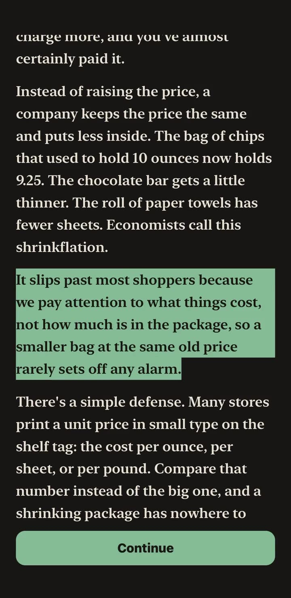
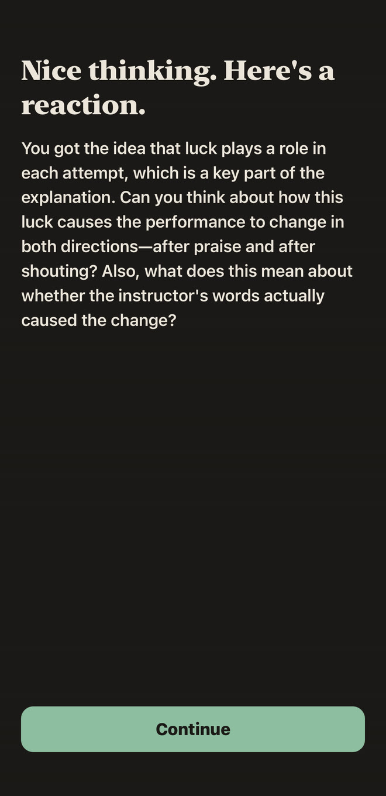

# DidRead

**A 5 to 10 minute daily reading and writing exercise for iPhone, for people who've noticed they reach for AI for small things they could do themselves.**

Read a short passage, answer one question, get short feedback that names one thing you did well and asks one question that pushes further, then come back tomorrow for a new one. The difficulty adapts quietly, and nothing about the app is built to make you feel ranked or guilty.

<p>
  
  &nbsp;&nbsp;
  
</p>

**Status:** in beta on TestFlight (build 7, November 2026). Website: [didread.app](https://didread.app).

> This is a public snapshot of the app's code and spec for my portfolio. Day-to-day development happens in a private repository, and internal notes, tester feedback, and most of the exercise library are kept there.

## What's in the app

- **The daily loop:** one read, one question, feedback, progress. Up to two bonus reads a day.
- **Question types:** open text (scored by AI against a rubric), multiple choice, tap the sentence, and put it in order.
- **Activities:** "Say it your way" free-writes, Bad Summary (spot what a summary gets wrong), Word Sprint (with a Relaxed mode that removes the timers), and six-word stories. A story series told in chapters is built and launches with its first approved series.
- **Word of the Day**, a weekly goal with a this-week strip, a Progress screen, and a daily reminder.
- **Accounts:** Sign in with Apple, sign out, and delete account (which also revokes the app's access to the person's Apple ID).
- **Works offline:** an answer typed without signal is kept on the phone and saved when the connection comes back.

## How it's built

```
iPhone app (Expo, React Native + TypeScript)      Backend (Supabase)
  Screens                                           Sign in with Apple
  ProgressionEngine (pure TypeScript, tested)  <->  Postgres with row-level security
  Offline outbox                                    score-response function  <->  AI model
```

**Rules the whole codebase follows** (from `docs/SPEC.md` and `CLAUDE.md`):

1. **AI scores; code decides.** Progression, difficulty, exercise selection, streaks, and user state are deterministic TypeScript in `src/engine/`, covered by unit tests. No AI call ever changes what a user sees next.
2. **AI output is validated before it's used.** The `score-response` function checks every model response against a JSON contract. Anything invalid, late, or over limit is saved as "unscored", never guessed.
3. **No secrets in the app.** The only AI call happens in the backend function, which holds the key, wraps the user's answer as data (so instructions inside an answer are ignored), and caps calls at 10 per user per day.
4. **Only approved content is served.** Exercises are human-written structured data with rubrics, checked by a script (`npm run check-content`) and imported into the database. Nothing is generated on the fly.
5. **Users only see their own data.** Row-level security on every table, with SQL tests that sign in as two accounts and prove neither can read the other's rows (`supabase/tests/`).

**Choosing the AI model with evidence.** `scripts/calibrate.ts` runs every exercise's anchor answers through several candidate models, five times each, and reports which models score them correctly and what each call costs. The cheapest model that passes is the one used, and the provider can change through configuration alone.

**Tests.** About 240 unit tests across the progression engine, session logic, reminders, content checks, the scoring contract, and the backend functions, plus SQL tests for the database security rules.

## How I built it

I wrote the product spec, made every product decision, and built the app with [Claude Code](https://claude.com/claude-code) as my AI pair programmer, testing every batch on my own iPhone. Two files run the process:

- **`docs/SPEC.md`** is the single source of truth: product rules, the AI feedback contract, the data model, screens, acceptance criteria for each build batch, and a decision log with a dated line for every product change.
- **`CLAUDE.md`** holds the rules the AI works under: never invent product rules, never put secrets in the app, keep the progression engine pure, and ask before adding any dependency.

The app was built in small batches, each with written acceptance criteria, and shipped to testers through TestFlight.

## Project layout

```
src/app/         Screens (Expo Router)
src/engine/      ProgressionEngine and its tests: bands, selection, review, streaks
src/state/       App state, saving, the offline outbox, analytics events
src/content/     The exercise catalog, loaded from the database
supabase/        Database migrations, SQL security tests, and backend functions
                 (score-response, calibrate-response, delete-account)
scripts/         Content checks, the importer, the model calibration script, the site builder
site/            The marketing website (didread.app)
docs/            The spec, all screen wording, the privacy policy, setup guides
docs/content/    Sample exercises (the full library is private)
```

## Running it

The app runs on an iPhone through a development build made with EAS, and it needs a Supabase project of its own (see `.env.example` and `docs/BATCH7-SETUP.md`). Without those, you can still run the tests:

```bash
npm install
```

```bash
npm test
```

## License

All rights reserved. The code and content are shown here for portfolio review and are not licensed for reuse.
